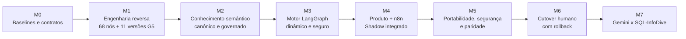

# Roadmap mestre — migração n8n + Gemini → n8n + LangGraph + Gemini

**Elaborado em:** 11/11/2026  
**Natureza:** estudo de planejamento e contrato de entregas; **não** autorização de merge, credencial, custo, SQL financeira, migração de banco, deploy ou cutover.  
**Fonte de precedência:** decisão mais recente do operador → `AGENTS.md` / `CHATGPT-PROJECT-INSTRUCTIONS.md` → `docs/architecture/PORTABILITY-AND-CUTOVER-CONTRACT.md` → `ORCHESTRATION-STRATEGY.md` → evidências operacionais.  
**Repositórios:** `leandrosilveiradepaula/agente-sql-langgraph` (motor) e `leandrosilveiradepaula/Agente-Financeiro` (Produto existente).

## 1. Visão de produto e limite de escopo

O produto não é greenfield, não abandona o n8n e não tem como objetivo reproduzir respostas das 63 perguntas por memorização.

A tarefa é estudar a inteligência real do sistema anterior, presente em **68 nós do workflow n8n** e no **banco/backup G5 de 11 versões**, identificar o significado de suas regras e comportamentos, preservá-los ou substituí-los em um motor **agnóstico de cliente** e eliminá-los do código/nós operacionais onde forem específicos da empresa anterior.

| Componente | Responsabilidade permanente |
|---|---|
| Produto Next.js | autenticação, tenant, política, aprovação humana, interface, histórico e observabilidade |
| n8n | webhooks, orquestração, conectores, cache operacional, tarefas determinísticas, coordenação da execução aprovada |
| LangGraph | compreensão semântica, seleção de contexto, planejamento, geração dinâmica de SQL, validações, proposta de reparo e evidências |
| Catálogo semântico por tenant | mapeamento físico/contábil, métricas, dimensões, granularidade, sinais, período, unidades, aliases, relações, filtros, regras e versões |
| Provider | Gemini inicialmente; SQL-InfoDive somente após Fase 2 e sem mudar o motor |

**Zero hardcode de negócio:** o processo é codificado; conhecimento do cliente é configurado e versionado. Não inserir em Python, TypeScript ou novos nós n8n nomes de cliente, colunas, DRE, aliases, métricas, joins específicos, SQL pronta, limiares casuísticos ou perguntas do benchmark. Um cliente sem DRE é válido. O banco/ERP de outro cliente pode ter esquema e nomenclatura completamente diferentes, com adaptador de dialeto aprovado. Ambiguidade contábil não vira inferência silenciosa.

## 2. Estado real no início deste roadmap

Verificado em 11/11/2026:
- `main` do motor: `955eda46015d35dbe44a40f9240b821b1f493201`; checkout registrado na VPS: `87d167969345c3dfcf9deaf36e33ab07a1f9c890`. Portanto, **a VPS ainda não incorpora o conteúdo da PR #233**.
- PR #233 (draft), SHA `2f037eba0efc804547ddba8afc7543f6f7444406`: inventário estrutural 68 nós / 78 conexões, matrizes funcionais e de hardcode, leitor de metadados PostgreSQL read-only, pré-validador físico do contexto e carregador de snapshot canônico por tenant/versão/fingerprint. CI Linux e Windows **SUCCESS**; não mergeada nem implantada.
- PRs #230 (interpretação portável opt-in) e #231 (papéis dos conceitos semânticos por tenant) permanecem **draft**. Exigem revisão de compatibilidade/integração; não presumir funcionalidades aprovadas ou em produção.
- Runtime consultado: n8n running, Shadow TEST healthy, `LANGGRAPH_ALLOW_REAL_SQL_EXECUTION=false`.
- G5: 11 versões históricas e cinco coleções com 1.381 registros; 106 SQL patterns históricos devem ser destinados à **avaliação somente**. Auditor atual encontrou 579 candidatos com vários nomes físicos ambíguos e apenas 11 pares únicos de referências tabela/coluna — **coocorrência textual não equivale a regra contábil comprovada**.
- 63 casos históricos n8n recuperados e congelados com recibo privado, sem SQL financeira executada pelo recuperador. **Não usar esses 63 casos como requisitos do gerador, exemplos para memorizar ou fonte de semântica**.
- P1/P2 tiveram evidências reais anteriores de geração e correlação no Shadow. Essas provas não homologam a migração integral do legado, paridade financeira, isolamento multicliente ou roteamento atual em produção.

Estado de gates do contrato G1–G6: G1 **parcial**, G2 **parcial**, G3 **não homologado**, G4 **parcial**, G5 **pendente**, G6 **pendente**. Não converter presença de código e CI em progresso financeiro fictício.

## 3. Linha de desenvolvimento e dependências

Trabalhos de segurança, testes, tracing e observabilidade atravessam todas as etapas; o onboarding iniciado na PR #233 pode ser desenvolvido em paralelo ao inventário, mas **não deve receber semântica histórica como aprovada antes de M1/M2**. Nenhuma etapa libera implicitamente a seguinte.

## 4. Marcos com entregáveis e critérios de aceite

### M0 — Consolidar a fundação e evitar duplicação de trabalho

**Entrada:** repositórios, PRs #230/#231/#233, contratos e runtime.  
**Execução:**
1. Revisar criticamente as três PRs draft, conflitos, interfaces, testes e sobreposição semântica; produzir decisão de integrar/retrabalhar/descartar por contribuição efetiva.
2. Congelar referência auditável do export oficial n8n, hash/version, backup G5 e contexto Shadow, sem copiar dados brutos para GitHub.
3. Confirmar os endpoints reais do Produto e os bindings n8n, distinguindo URL fallback no código de variável efetiva de runtime.
4. Definir um único painel por capacidade/gate, rastreando evidência, responsável, commit e pendência, sem porcentagens artificiais.

**Saída:** baseline e fila consolidada de migração por capacidades reais.  
**Aceite:** nenhuma função sendo reimplementada duas vezes; nenhum merge/deploy/credential change implícito.

### M1 — Engenharia reversa semântica integral do legado (**caminho crítico**)

**Entrada:** export dos 68 nós + banco/backup G5 cifrado, 11 versões segregadas.  
**Execução:**
1. Analisar privadamente **41 Code, 11 PostgreSQL, 10 IF, 2 HTTP, 3 Respond e 1 Webhook**; identificar todas as condições, efeitos, SQL, filtros, joins, prompts, I/O, tratamento de erros, cache, logs e caminhos externos, inclusive 8 nós fora da rota direta do webhook.
2. Inspecionar **conteúdo integral necessário** das 11 versões do G5 em ambiente isolado, com GPG desbloqueado localmente por custódia aprovada; jamais publicar textos contábeis sensíveis nem misturar versões.
3. Para cada comportamento, produzir ligação **nó/ramo → objeto/versão do banco → definição contábil → efeito financeiro → classificação STRUCTURAL/TRANSITIONAL/FORBIDDEN → destino → teste**.
4. Separar comportamento genérico do n8n de inteligência financeira local. Não inferir sinal, contabilidade ou coluna por semelhança textual. Registros sem correspondência viram pendências de validação com responsável, não código especial.
5. Identificar o subconjunto de comportamentos que realmente pode continuar determinístico no n8n e o que deve migrar para LangGraph/contexto.

**Saída:** catálogo rastreável de comportamentos antigos e regras versionadas candidatas, com pendências contábeis explícitas.  
**Aceite:** **100% dos comportamentos relevantes inventariados e classificados**, cada regra financeira com origem/versionamento e status; nenhum hardcode específico incorporado ao novo código; lacunas não certificadas permanecem bloqueadas. O inventário estrutural já existente não satisfaz sozinho este gate.

### M2 — Ontologia/catálogo universal e onboarding por cliente

**Entrada:** comportamentos/proveniência M1, leitor físico e repositório canônico inicial da PR #233.  
**Execução:**
1. Definir o contrato canônico: fontes/schemas, tipos, relações e cardinalidades; granularidade, dimensões, medidas, fórmulas derivadas, sinais, moedas, calendário/períodos, unidades, contexto de filtro, políticas e rastreabilidade.
2. Modelar **declarações de conhecimento opcionais**: DRE/IMD, orçamento, realizado, contas, marcas, centros de custo etc. só aparecem quando o cliente efetivamente os possui e aprova.
3. Desenvolver descoberta física autorizada e mapeamento assistido com confirmação de especialista; os nomes/fórmulas propostos pela LLM não são considerados aprovados.
4. Criar publicação e rollback do catálogo por **tenant + versão + fingerprint + responsável + trilha de aprovação**, sem leitura cruzada, segredos em logs ou SQL histórica no gerador.
5. Provar que o grafo seleciona seu repository/credencial/versão **a partir da identidade autenticada pelo Produto**, jamais da pergunta. Separar metadados, dados financeiros e benchmark.
6. Para PostgreSQL, aproveitar `physical_catalog_reader.py`; demais tecnologias entram por **adaptador de metadata/dialeto** com contrato uniforme, implementado conforme necessidade real, não por branches especiais de cliente.

**Saída:** procedimento repetível para configurar e homologar qualquer tenant *nas tecnologias/adaptadores suportados*.  
**Aceite:** dois contextos materialmente distintos são aceitos com **o mesmo código**, sem DRE obrigatória; mappings desconhecidos bloqueiam operação; RLS/grants, versionamento, revogação e tenant routing verificados.

### M3 — Motor NL→SQL financeiro completo e genérico

**Entrada:** catálogo M2 versionado e aprovado.  
**Execução:**
1. Interpretar pergunta inédita em métricas, entidades, dimensões, filtros, períodos e operações; resolver ambiguidades com catálogo e pedir esclarecimento quando necessário.
2. Planejar métricas, joins, fonte, sinais, períodos, agregações e operações com evidência de autorização e grão compatível.
3. Gerar SQL **dinamicamente**, com dialeto injetado, jamais SQL fixa por pergunta.
4. Aplicar Security Gate/Contract Gate/preflight, bloqueio de colunas/tabelas/joins não autorizados, cardinalidade, limite de custo/linhas e modo read-only.
5. Reparar SQL apenas de modo propositivo; qualquer mudança deve invalidar aprovação anterior (`requires_reapproval=true`).
6. Reconstituir comportamentos do legado identificados em M1 (cache, reports, errors, sign convention etc.) colocando-os na camada correta; remover resquícios financeiros de código genérico.
7. Executar testes **inéditos e adversariais**, sem benchmark no prompt/planejador, com métricas de cobertura por capacidade e sem redução de thresholds.

**Saída:** motor capaz de interpretar e produzir SQL financeiramente explicável a partir do contexto configurado.  
**Aceite:** nenhuma intenção/alias/SQL hardcoded; plano e SQL rastreáveis; falha fechada em semântica ambígua; testes em dois modelos de dados distintos, não só variações de frases.

### M4 — Integração real com Produto + n8n e Shadow

**Entrada:** M3 suficientemente estável; endpoints Produto reais identificados.  
**Execução:**
1. Integrar o Produto existente (incluindo `/api/generate-sql` e rota real de execução `/api/execute-watson`, sujeitas à confirmação do deployment) ao n8n e ao LangGraph.
2. Preservar orquestração n8n, políticas Next.js, logs, cache, conectores e aprovações. Deslocar **somente** as decisões inteligentes antigas, mantendo Gemini como provider comum durante Shadow.
3. Estabelecer contratos separados: `Generate`, `Repair` e `Execute Approved`. Nunca inferir aprovação do nome de um nó n8n ou de SQL tecnicamente válida.
4. Correlacionar `agent_run_id`, `run_id`, `shadow_record_id`, fingerprint SQL e contexto, versão, tenant, gates, provider/model, tempos, tokens e resultados.
5. Evitar dupla execução e corrida entre request/repair/approve/executor; preservar retorno oficial n8n+Gemini e circuit breaker/rollback do Shadow.
6. Confirmar binding **efetivo** Produto→webhook, S2S, status e uso de credenciais reais sem expor secretos.

**Saída:** mesmo pedido corre no caminho oficial e em Shadow, em paralelo, de forma rastreável.  
**Aceite:** evidência real end-to-end da mesma tentativa; nenhum efeito adicional no retorno oficial; n8n operacional preservado; execução SQL financeira real do Shadow ainda **desabilitada**.

### M5 — Homologação de portabilidade, paridade financeira e segurança (G1–G4)

**Entrada:** M4 estável e M2/M3 aprovados, ambiente e credenciais adequados.  
**Execução:**
1. Testar **ao menos dois clientes/contextos reais materialmente distintos**, com permissão, esquema e vocabulário distintos. Se não houver segundo cliente autorizado, não declarar universalidade comprovada.
2. Separar ensaios em: semântica/planos; SQL/gates; produção de resultados financeiros; produto/fluxo operacional.
3. Realizar perguntas inéditas e negativas antes da avaliação formal: ambiguidade, falta de métrica, fonte sem dados, joins incorretos, cross-tenant, período, moeda, sinal e permissão.
4. Usar as **63 perguntas históricas apenas na comparação cega**, com saídas da arquitetura antiga e nova produzidas independentemente. SQL textual diferente pode ser semanticamente equivalente; baseline antigo também pode estar incorreto.
5. Autorizar e executar testes **numéricos read-only em etapa separada**, com credencial isolada, mesmas condições/snapshot e reconciliação contábil humana; não ativar `LANGGRAPH_ALLOW_REAL_SQL_EXECUTION` implicitamente.
6. Definir tolerâncias monetárias e critérios de severidade **com o responsável financeiro**, não ajustar thresholds para o benchmark. Corrigir capacidade geral e repetir contraprovas.
7. Exercitar RBAC, aprovação/reaprovação, isolamento, rollback operacional, falhas dos provedores, observabilidade e recuperação.

**Saída:** relatório de equivalência, cobertura, desvios resolvidos/aceitos explicitamente e readiness real de G1–G4.  
**Aceite:** nenhuma divergência financeira ou de segurança material sem resolução/decisão humana; evidência auditável e testes de portabilidade real; liberação de cutover **não automática**.

### M6 — Cutover humano e controlado (G5)

**Entrada:** M5 homologado, aprovação humana formal, runbook de rollback, janela de operação e observabilidade real.  
**Execução:** usar feature flag/canário; mover a **inteligência oficial** de n8n+Gemini para **n8n+LangGraph+Gemini**; preservar webhooks, conectores, operação n8n e Produto; acompanhar erros/latência/números; executar rollback se houver critério de falha; documentar evidência pós-corte.

**Saída:** caminho oficial n8n+LangGraph+Gemini sob controle humano.  
**Aceite:** canário + observação + rollback testado + autorização explícita + evidência sem regressão material. Merge e CI verde não significam autorização.

### M7 — Benchmark de modelos Gemini vs SQL-InfoDive (G6)

**Entrada:** M6 homologado e estável.  
**Execução:** comparar Gemini e SQL-InfoDive no **mesmo** motor, catálogos, perguntas inéditas, credenciais e critérios; avaliar SQL/semântica, qualidade financeira, repair, latência, tokens/custo e falhas. Não usar troca de LLM como correção de defeitos no planner ou contexto.

**Saída:** decisão auditável de provider configurável por implantação/tenant, sem mudar código de negócio.  
**Aceite:** paridade ou diferenças explicadas e homologadas; política e privacidade verificadas.

## 5. Priorização de risco e caminho crítico

| Risco ou bloqueio | Impacto | Tratamento |
|---|---|---|
| 11 pacotes G5 cifrados sem revisão financeira integral | **Crítico**: regras e mapeamentos não verificáveis | Desbloqueio offline sob custódia, inventário por versão, validação contábil |
| Hardcodes espalhados em JavaScript e relatórios n8n | **Crítico**: motor antigo implicitamente cliente-específico | Classificação/externalização comportamento a comportamento, sem portar regras em código |
| Adaptador antigo DuckLake/DRE e semântica incompleta | **Alto**: outros esquemas não funcionam sem ajustes | Snapshot canônico, glossário/versionamento e planner sem nomes fixos |
| Tenant por config global em instância multiempresa | **Alto**: risco de roteamento ou vazamento cruzado | Binding de principal no Produto, isolamento de repositories/secrets e RLS/ACL |
| Fluxo de geração/reparo alcança executor legado | **Crítico**: execução sem aprovação nova | Contratos separados, fingerprint por autorização e reaprovação após repair |
| SQL válida com número financeiro incorreto | **Crítico**: erro silencioso de negócio | Paridade numérica autorizada, sinais/joins/grão, validação por responsável financeiro |
| Uso de 63 golden answers como contexto | **Alto**: benchmark artificial e overfit | Corpus do avaliador segregado, teste de não vazamento, perguntas inéditas |
| Cutover sem rollback ou monitoramento | **Crítico**: regressão operacional | Canário, flags, evidência correlacionada, runbook e humano no gate |

**Caminho crítico:** desbloqueio/revisão G5 → crosswalk semântico completo → catálogo aprovado → motor sem hardcode → Shadow integrado → paridade financeira e multicliente → cutover autorizado.

O trabalho de documentação/CI não deve ocultar esses bloqueios. Um item só conta como concluído quando **funciona na jornada real** e há evidência suficiente, não quando foi criado um arquivo.

## 6. Estratégia de execução: blocos substantivos, não micro-PRs

Agrupar em entregas coerentes, com revisão humana de merge:
1. **Entrega A (M0+M1):** fonte real + matriz de regras/efeitos, semântica rastreada G5, ledger classificado e lacunas nomeadas.
2. **Entrega B (M2+M3):** catálogo governado e motor dinâmico, com tenant routing e portabilidade; aproveitar/conciliar PRs #230/#231/#233.
3. **Entrega C (M4):** integração Produto/n8n/LangGraph, aprovações separadas, logs correlacionados e Shadow real sem SQL financeira.
4. **Entrega D (M5):** teste real multicliente, comparação semântica e financeira mediante gates, 63 perguntas somente QC final, correção de capacidades e relatório.
5. **Entrega E (M6):** canário, cutover, rollback e estabilização após aprovação.
6. **Entrega F (M7):** comparação Gemini x SQL-InfoDive após estabilização.

Cada entrega deve trazer mudanças concretas em código e/ou contexto **relacionadas a uma jornada completa**, testes, evidência, riscos, artefatos e SHA/PR reais. Não abrir PRs somente para elevar pontuação ou recontar métricas.

## 7. Cronograma indicativo — condicionado a capacidade e gates

**Não há data de entrega confiável até confirmar a disponibilidade de desbloqueio G5, um especialista financeiro que aprove as regras e dois contextos reais.** Para planejamento de capacidade (não compromisso de prazo), considerar o seguinte cenário-base com **duas pessoas técnicas dedicadas**, apoio operacional do n8n/Produto e **responsável contábil disponível para validações**:

| Bloco | Ordem | Esforço inicial indicativo (semanas corridas) | Observação |
|---|---|---:|---|
| M0 — reconciliação de baseline/PRs | primeiro | 0,5–1 | Pode ocorrer junto à preparação G5 |
| M1 — inventário semântico completo | crítico | 2–4 | Principal incerteza: acesso e significado contábil |
| M2 — catálogo e onboarding governado | após M1 inicial | 2–4 | Parte de código já existe na PR #233 |
| M3 — LangGraph dinâmico/sem hardcodes | após M2 mínimo | 3–5 | Sobrepõe M2 parcialmente |
| M4 — integração n8n/Produto/Shadow | após contrato M3 | 2–3 | Depende de rotas/identidade efetivas |
| M5 — prova de portabilidade/paridade/segurança | após M4 | 3–5 | SQL financeira depende de autorização própria |
| M6 — canário/cutover/observação | após M5 | 1–2 | Gate de aprovação humana |
| M7 — comparação dos LLMs | **após M6** | 1–3 | Fora da homologação inicial |

Essas faixas são **hipóteses de planejamento**, não foram inferidas de velocidade histórica de commits nem equivalem a promessas. O sequenciamento permite sobreposição seletiva entre M1/M2 e M2/M3; assim, uma referência inicial seria aproximadamente **12–20 semanas até estabilizar a arquitetura com Gemini**, somente no cenário-base e **sem bloqueios de acesso, domínio ou autorização**; modelos depois. Se faltarem especialistas, ambientes ou clientes, o cronograma deve ser reestimado. Registrar o esforço real da primeira entrega A para calibrar.

## 8. Intervenções do operador e responsáveis

| Gate humano | Necessidade concreta | Momento |
|---|---|---|
| Custódia G5 | Senha GPG usada **localmente na VPS**, sem revelar no chat, para revisão isolada por versão | M1 |
| Responsável financeiro | Aprovar sentido de métricas, sinais, fórmulas, mapeamentos e critérios de paridade; não inventar significados | M1–M2 e M5 |
| Merge/deploy/migration | Aprovar PRs revisadas, persistência do catálogo, RLS, secrets e alterações de runtime | M0/M2/M4 |
| Segundo contexto real | Disponibilizar tenant/base materialmente distinta e autorizações de metadata/read-only | M2/M5 |
| Comparação numérica | Autorizar operação **separada** SELECT-only, sem habilitar Shadow financeiro implicitamente | M5 |
| Cutover | Aprovar canário, janela, plano de rollback e mudança de fluxo oficial | M6 |
| Custo/LLM privada | Aprovar ensaio limitado e eventual uso de SQL-InfoDive | M7 |

Não pedir autorização genérica repetidamente para leitura de código, GitHub, documentação, inspeção sanitizada ou testes offline que já estejam dentro das capacidades e permissões vigentes.

## 9. Definição objetiva de produto concluído

A arquitetura n8n+LangGraph+Gemini só pode ser considerada pronta quando:

- Os **68 nós/branches relevantes** e o conteúdo semântico do G5 estiverem rastreados, e toda regra de negócio necessária tiver destino e teste;
- Não existir **hardcode específico de cliente** no novo motor nem na nova inteligência operada pelo n8n;
- O onboarding de uma empresa nova ocorrer por credencial, configuração, catálogo, homologação e adaptadores **sem modificar o motor**;
- Dois contextos reais materialmente distintos funcionarem em isolamento com perguntas inéditas;
- Semântica, planos, SQL e resultados financeiros estiverem validados com evidência e aprovação de segurança/contabilidade;
- Generate, Repair e Execute Approved operarem como operações distintas, com reaprovação de qualquer SQL alterada;
- O Produto e o n8n permanecerem funcionais e observáveis, com correlacionamento real;
- Existirem rollback, documentação de execução, operação e gate humano de cutover;
- A decisão final tenha um pacote de evidências assinado por responsáveis, não somente CI verde ou 63 perguntas respondidas.

**Próxima entrega recomendada:** M0 + M1, iniciando pelo **conteúdo real das 11 versões G5 e comportamento dos nós 6/7/8/22/23/32/54**, expandindo a todos os outros 68 nós, preservando a cadeia de correlação e a classificação STRUCTURAL/TRANSITIONAL/FORBIDDEN. Não começar outra rodada de benchmark nem criar mais um interpretador paralelo antes de concluir o crosswalk.
